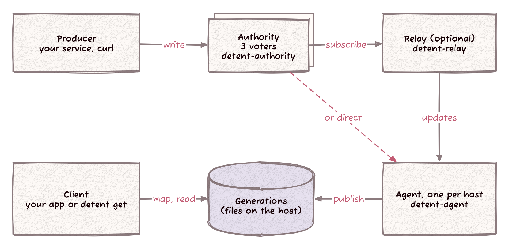

# Detent (C++)

A detent is the click-stop that holds a knob at its setting. Detent is a C++ runtime-configuration library for namespaced 64-bit integer knobs, plus a durable authority daemon (`detent-authority`) and a host-local managed agent (`detent-agent`). Its model (knobs, namespaces, groups, overrides, rollout and evaluation) is specified in [`docs/design/knob-model.md`](docs/design/knob-model.md); around it Detent adds authenticated transactional publishing, durable Raft consensus, and incremental delivery to hosts.

**New here?** [`QUICKSTART.md`](QUICKSTART.md) covers numeric settings, feature flags, gradual rollouts, group overrides, and per-read fallbacks. The [usage guide](docs/USAGE.md) covers network distribution, configuration, and library examples.

## What this is

- Applications read through `libdetent_reader`, one reader core behind a C ABI (`include/detent/reader.h`). C++ wraps it as `detent::Reader`; the Python and Rust bindings wrap the same ABI. A lookup maps the agent's generation read-only, never touches the network, and never allocates once warm.
- Every lookup takes the caller's fallback and returns it on any error: a missing knob, a store with no generation yet. `lookup()` also reports the status. Defaults live in each call's fallback.
- Every knob holds one `int64` value; a feature flag is a knob whose values are 0 and 1. Any knob supports exact-match group overrides and a stable SHA-256 percentage rollout to a `rollout_value`.
- `detent-authority` is the durable authority: bounded namespace transactions, publisher credentials, and Raft consensus over mutual TLS with a journal on each voter.
- `detent-agent` receives authenticated deliveries from the authority and publishes immutable local generations, which `detent get` maps read-only for shell scripts and other non-C++ callers.

## How Detent fits together



A knob change moves through five actors:

- **Producer**: your service, writing changes as namespaced transactions with `POST /v2/transactions` over HTTPS.
- **Authority**: `detent-authority --authority authority.json` on three machines, one voter each. The voters replicate with Raft over mutual TLS and keep the journal on their own disks. This is the source of truth.
- **Relay** (optional): `detent-relay`, following the authority, mirrors each namespace's sealed history and serves full copies and changes to many agents.
- **Agent**: `detent-agent`, one per host. It receives full copies and changes per namespace and publishes immutable local generations on disk.
- **Client**: your application, through `detent::Reader` (or the Python and Rust `Reader`), mapping the agent's selected generation and reading in memory. `detent get` is the command-line client.

This is the managed profile, the topology the [production contract](docs/PRODUCTION_CONTRACT.md) targets. [Detent's actors](docs/ACTORS.md) says what each actor does, how, when and where, including ports, files, build options and restart behavior.

## Using it in your own application

### 1. Pull it in (CMake FetchContent)

```cmake
include(FetchContent)
FetchContent_Declare(detent
  GIT_REPOSITORY https://github.com/Kronuz/Detent.git
  GIT_TAG        main)
FetchContent_MakeAvailable(detent)

target_link_libraries(my_app PRIVATE detent::reader)
```

For reproducible builds, replace `main` with the commit you have qualified. A local checkout can also be included with `add_subdirectory()`.

### 2. Open a `Reader` and read knobs

```cpp
#include "detent/reader.hh"

// The agent's generation directory, and the uid the agent runs as.
detent::Reader reader(generation_dir, agent_uid);

bool killswitch = reader.get_as<bool>("checkout:killswitch_new_path", false);
std::int64_t max_results = reader.get("search:max_results", 25);
bool enabled = reader.get_as<bool>("payments:new_processor", false, user_id, user_group);

auto result = reader.lookup("search:max_results", 25);
if (!result)
    log(detent_status_name(result.status));
```

Open one `Reader` per process and share it; lookups are thread-safe. Only the constructor throws (`detent::ReaderError`, whose `status()` says why); every lookup returns its fallback on any error. A store that does not exist yet opens, and lookups return the fallback with `DETENT_UNAVAILABLE` until the agent publishes. An optional third argument limits the handle to a list of namespaces, and a fourth caps the bytes it maps (0 means 512 MiB). `refresh()` attaches a newer generation now instead of on the next lookup, and `revision(namespace)` reports the attached revision. The worked example is [`examples/demo.cc`](examples/demo.cc).

### 3. Run the authority

Start a voter with `detent-authority --authority authority.json` and publish with `POST /v2/transactions`; the [durable authority guide](site/src/content/docs/guides/durable-authority.md) walks through the configuration and a first transaction.

### 4. Testing

Tests publish real generations into a store with `detent::testing::Store` (`include/detent_testing/store.hh`, target `detent::testing`) and read them through a `Reader`, the same path production takes:

```cpp
#include "detent_testing/store.hh"

detent::testing::Store test_store(store);  // creates the store directory (0700)
test_store.publish(R"({"schema_version":1,"knobs":{"search:max_results":{"default":3}}})");
detent::Reader reader(store, ::getuid());
```

`libdetent_testing` is a development component: built in-tree, or installed with `cmake -DDETENT_INSTALL_TESTING=ON` and `cmake --install BUILD --component development`, which installs it, `libdetent_reader` and their headers for `find_package(Detent)` (targets `detent::reader`, `detent::testing`). Never link it into a shipped binary.

Directory trust refuses a store with a group- or world-writable ancestor, so keep test stores under the build tree, not `/tmp`.

## What the repository contains

The client implements the [knob model](docs/design/knob-model.md), and a distribution layer carries it to hosts:

- `detent`: the knob model, schema validation and rollout hashing.
- `libdetent_reader`: the reader core and its C ABI, wrapped by `detent::Reader`.
- `detent-authority`: the durable authority daemon.
- `detent-agent`: host-local managed agent that publishes immutable generations for non-C++ readers.
- Python and Rust bindings over the reader core's C ABI.

The wire format remains `schema_version: 1`. Full snapshots, PATCH payloads, and diff responses all validate through the same schema machinery.

## Dependency graph

```text
detent
  |-- atomic-shared-ptr
  |-- sha256 (+ endian)
  |-- char-classify
  |-- strict-stox
  `-- random

detent-agent (exe)
  |-- detent::delivery_config   # managed delivery over TLS
  `-- detent
```

`detent` has no networking dependencies. `detent-authority` pulls the HTTP framework plus `consensus` for durable Raft. `detent-agent` links the managed delivery libraries; `detent get` links only the local reader.

## Dependencies

All dependencies are fetched with CMake `FetchContent`.

| Library | Role |
|---|---|
| [`atomic-shared-ptr`](https://github.com/Kronuz/atomic-shared-ptr) | Snapshot publication |
| [`sha256`](https://github.com/Kronuz/sha256) (+ `endian`) | Stable rollout-bucket hash |
| [`char-classify`](https://github.com/Kronuz/char-classify) | Knob-name validation |
| [`strict-stox`](https://github.com/Kronuz/strict-stox) | Strict integer parsing |
| [`random`](https://github.com/Kronuz/random) | Full-jitter reconnect backoff |
| [`compressors`](https://github.com/Kronuz/compressors) | zstd/gzip: distribution frame codecs |
| [RapidJSON](https://github.com/Tencent/rapidjson) | Strict JSON parsing |
| [`http`](https://github.com/Kronuz/http) (+ `reactor`, `http-parser`, `radix-router`) | `detent-authority`'s HTTP service |
| [`consensus`](https://github.com/Kronuz/consensus) | `detent-authority`'s durable Raft, with journal and completion I/O |
| standalone Asio | Pulled transitively by `http` and `consensus` |

RapidJSON runs in strict mode here. Unknown fields and malformed snapshots are rejected rather than partially applied. It is pinned to upstream commit `24b5e7a8b27f42fa16b96fc70aade9106cf7102f`; the older 1.1.0 release contains a `GenericStringRef` assignment operator that fails to compile with Clang 23.

## Layout

```text
include/
  detent/              Model, schema and the reader API (reader.h, reader.hh)
  detent_distribution/ Binary protocol, storage and shared sessions
  detent_distribution_http/ Optional server grammar and owned replies
  detent_relay/        Durable cache and session adapters
  detent_local/        Immutable views and durable generations
  detent_delivery/     TLS client and publication coordinator
  detent_transport/    TLS configuration

src/
  detent/              Model and schema implementation
  detent_reader/       Reader core (libdetent_reader)
  detent_agent/        Agent host and managed configuration
  detent_authority/    Durable authority, transactions, distribution and its daemon
  detent_distribution/ Protocol and session implementation
  detent_distribution_http/ Shared server parsing and reply pumping
  detent_relay/        Durable relay core
  detent_local/        Image building and persistence
  detent_delivery/     Session transport and coordinator
  detent_cli/          Shared configuration, logging and daemon lifecycle

tests/                 Matching component suites
examples/
benchmarks/
diagrams/
bindings/
```

## What the source modules build

The model and the reader have no networking dependency. Binary distribution, immutable local views, durable publication and managed TLS delivery are separate targets, so consumers can select the source and storage profile they need. Authority implementation targets remain internal to the daemon and its tests.

Managed agents write paged generations, one store entry per namespace, for incremental immutable local publication. See [the local image format](docs/LOCAL_IMAGE_FORMAT.md) for collection and disk accounting.

| Module | Main target | Purpose |
| --- | --- | --- |
| Model | `detent::detent` | Knob model, JSON schema and rollout hash |
| Reader | `detent::reader` | `libdetent_reader`: lookups over mapped generations behind a C ABI |
| Binary protocol | `detent::distribution` | Canonical codecs, bounded storage, staged frames and shared session lifecycle |
| Distribution server transport | `detent::distribution_http` | Optional strict request parsing and owned HTTP replies |
| Relay HTTP runtime | `detent::relay_http` | Bounded authenticated intake and shared-frame replies |
| Relay host | `detent_relay_host`, `detent-relay` | Optional TLS daemon serving mirrored namespaces; [qualification and configuration](docs/RELAY.md) |
| Relay mirror | `detent::relay_mirror` | The relay's namespace mirror: sealed history, blocks and bases |
| Immutable local view | `detent::local_view` | Read mapped durable generations |
| Local publication | `detent::local_publication` | Reconcile and publish durable generations |
| Managed transport | `detent::delivery_transport` | Incremental TLS delivery and sessions |
| Managed coordinator | `detent::delivery_coordinator` | Join source delivery to local publication |
| Private source configuration | `detent::delivery_config` | Validate source credentials, scope, TLS and publication limits |

## Binaries and their dependencies

| Binary | Built from | Links | What it is |
|---|---|---|---|
| `detent_demo` | `examples/demo.cc` | `detent::reader` | Opens a `Reader` over an agent's store and reads with fallbacks |
| `detent-authority` | `src/detent_authority/main.cc` | `detent_authority_service` -> authority, `http::http`, `consensus::consensus` | Durable authority daemon |
| `detent-relay` | `src/detent_relay/main.cc` | Relay host, private configuration and bounded TLS distribution | Optional durable fan-out daemon; Stage 5B qualification |
| `detent-agent` | `src/detent_agent/main.cc` | CLI and managed delivery libraries | Host-local managed agent |
| `detent` | `src/detent_agent/main.cc` | CLI and local reader libraries | Host-local `get` reader |
| `test_*` (`tests/detent/`, `tests/detent_reader/`) | `tests/detent/*.cc`, `tests/detent_reader/*.cc` | `detent`, `detent::reader` | Model and reader correctness suites |

## Build

The C++20 standard library must provide `std::jthread` and stop tokens; configuration checks this before building. libc++ 20 and newer expose these normally. FreeBSD 14.4 with base libc++ 19 requires an explicit `-DCMAKE_CXX_FLAGS=-fexperimental-library` when configuring; this opts into libc++'s experimental API/ABI and must also be used by consumers of the public C++ headers. Prefer a stable implementation when available. See [LLVM 19 documentation](https://releases.llvm.org/19.1.0/projects/libcxx/docs/UsingLibcxx.html) and [LLVM 20 release notes](https://libcxx.llvm.org/ReleaseNotes/20.html).

The authority integration tests require Python 3, Bash, curl, and the OpenSSL command-line tool on `PATH`. Bash is not part of FreeBSD's base system; install it before running the tests. These tools are test dependencies and are not required by the running daemons.

```sh
cmake -B build
cmake --build build -j
ctest --test-dir build --output-on-failure
./build/examples/detent_demo STORE_DIR AGENT_UID
```

`DETENT_BUILD_AUTHORITY` defaults to `ON`. Set `-DDETENT_BUILD_AUTHORITY=OFF` to skip `detent-authority` and its HTTP and consensus dependency chain. `DETENT_BUILD_PYTHON` and `DETENT_BUILD_RUST` default to `OFF`.

### Binary size

Measured on macOS/arm64 for `detent-agent`:

| Build | Size |
|---|---|
| Unset `CMAKE_BUILD_TYPE` | 1.15 MB |
| `Release` | 295 KB |
| `Release` + `strip -x` | 242 KB |

Most of the difference comes from RapidJSON and ordinary C++ runtime support.

### Running detent-authority

```sh
./build/src/detent-authority --authority authority.json
```

`detent-authority` listens on port `8317` unless `--port` says otherwise, and serves the authority named by `--authority` (or the `authority` field of `detent-authority.json`). `detent-authority.json` lives in the same platform config directory as `detent-agent.json` and accepts `authority`, `port`, `reactors`, `runtime_dir` and the logging fields; relative paths are resolved against the config file. `--config PATH` selects another file. CLI arguments override `DETENT_AUTHORITY_*` environment variables, which override config. `detent-authority --status` reports health over plain HTTP, or over HTTPS when the authority's publisher uses TLS. See [the durable authority guide](site/src/content/docs/guides/durable-authority.md) and [the `detent-authority` reference](site/src/content/docs/reference/cli/detent-authority.md).

### Running detent-agent

With a managed configuration (see [managed authority delivery](docs/USAGE.md#managed-authority-delivery)) and a running authority:

```sh
./build/src/detent get search:max_results --managed managed.json
./build/src/detent-agent --status --managed managed.json
kill -TERM "$(./build/src/detent-agent --status --managed managed.json | awk '/^running/ {gsub(/[^0-9]/, "", $3); print $3}')"
```

`get` starts the agent when no durable generation is present. With neither `--managed` nor `--generation-dir` (or `managed_path` and `generation_dir` in `detent-agent.json`), `detent get` and `detent-agent` exit with `no source configured`. For persistent settings, put `detent-agent.json` in the platform's user config directory (`~/.config/detent` on Linux/FreeBSD, `~/Library/Application Support/Detent` on macOS):

```json
{"managed_path": "managed.json", "generation_dir": "agent-state"}
```

`--config PATH` selects another config file. `--default VALUE` provides the fallback for that read.

Runtime files use `$XDG_RUNTIME_DIR/detent`, falling back to a private `detent-<uid>` directory under the system temporary directory. `runtime_dir`, `--runtime-dir`, or `DETENT_RUNTIME_DIR` selects another directory. Stop the agent to apply changed startup settings. See [the usage guide](docs/USAGE.md#persistent-agent-configuration) for system config locations and precedence.

## Language bindings

Enable bindings explicitly:

```sh
cmake -B build -DDETENT_BUILD_PYTHON=ON -DDETENT_BUILD_RUST=ON
cmake --build build -j
```

Both bindings mirror `detent::Reader` over the same C ABI ([design](docs/design/client-local-source.md) D1-D3): only opening raises (`ReaderError`), every lookup returns its fallback on any error, and the handle closes when the object ends, with no `close()`.

- **Python** (`bindings/python/`): a C extension, `detent.Reader(store, publisher_uid, namespaces=(), mapping_bytes=0)`, with `Status` and `Lookup`.
- **Rust** (`bindings/rust/`): `detent::Reader::open(store, publisher_uid, &[..], mapping_bytes)` returning `Result<Reader, ReaderError>`, with `Status`. The crate links the CMake-built shared `libdetent_reader` and compiles no C++.

Python example:

```python
import detent

reader = detent.Reader(generation_dir, agent_uid)
reader.get_bool("payments:new_processor", False, hash="user-42")
reader.get_bool("checkout:new_flow", False, switch_value="beta_testers")
reader.get("search:max_results", 25)
reader.lookup("search:max_results", 25).status
```

Rust example:

```rust
let reader = detent::Reader::open(generation_dir, agent_uid, &[], 0)?;
reader.get_as("payments:new_processor", false, Some("user-42"), None);
reader.get_as("checkout:new_flow", false, None, Some("beta_testers"));
reader.get("search:max_results", 25, None, None);
reader.lookup("search:max_results", 25, None, None);
```

## Testing

CTest registers component and process tests for the enabled build profiles. Use `ctest --test-dir build -N` to list the exact set for your configuration.

1. Model and reader tests cover schema validation, rollout vectors, evaluation, generation switches, fork and syscall-free lookups, and one scenario table (`bindings/tests/scenarios.json`) that C++, Python and Rust all run.
2. Authority tests cover transactions, durable storage, authenticated consensus, restart and failure recovery, bounded distribution, subscription admission and large-state idling.
3. Protocol, local-view and delivery tests cover binary validation, mapped generations, original IO settlement, publication reconciliation and exact source feedback.
4. Process fixtures start real daemons, exercise HTTP and local readers, and stop or kill tracked processes.

## Benchmarks

Benchmarks in `benchmarks/` build by default. Measured output on one 14-core arm64 development machine:

| Benchmark | What it measures | Command | Result |
|---|---|---|---|
| `detent_hash_bench` | `stable_bucket()` only | `detent_hash_bench 5000000` | 5.05M calls/sec (198.2 ns/call) |

`reader_bench` measures warm lookups through `libdetent_reader`; its usage is in the header of `benchmarks/reader_bench.cc`.

### Security boundary

`detent-authority` authenticates publishers with bearer tokens, voters with mutual TLS and a certificate pin, and bounds every admission layer; see [Security](site/src/content/docs/operations/security.md). Host-local reads trust the host.

### Consistency model

Within one authority group, transactions commit in a single replicated log and the authority assigns revisions.

## Production readiness: honest checklist

| Area | Status | Detail |
|---|---|---|
| Correctness (reader) | **Proven** | Golden hash vectors, the reader core, generation switches under threads, and the shared scenario table in C++, Python and Rust |
| Correctness (host-local agent) | **Proven** | Managed-process and system suites: delivery, restart, failover and reads |
| Linux sanitizer coverage | **Proven on Linux** | ASan/UBSan and TSan run clean across the full suite (multiple stress repetitions) |
| Real network conditions | **Not done** | Current measurements are loopback-only |
| Soak/long-run stability | **Not done** | No multi-hour or multi-day validation documented |


System-wide deployment: see [System services](docs/SERVICES.md) for service accounts, directory ownership, supervision, and logging on Linux, FreeBSD, and macOS.

The shell reader is `detent get NAME`. Both daemons run directly in the foreground, accept `--daemonize` for user background operation, and provide read-only `--status`. Send SIGTERM to stop a user daemon; supervised services use their service manager. The reader launches a sibling `detent-agent` binary, or finds it on `PATH` when invoked by name.

### Rollouts by group

An override is an integer that forces the group's value, or an object containing only `rollout_pct` (an integer from 0 to 100). A knob with any percentage also carries `rollout_value`, the value callers inside the percentage get:

```json
"overrides": {"employees": 1, "beta": {"rollout_pct": 50}, "production": {"rollout_pct": 5}},
"rollout_pct": 10, "rollout_value": 1
```

A matching group rollout replaces the knob-wide rollout percentage and uses the same hash bucket: a caller inside it gets `rollout_value`, and a caller outside it gets the default. Without a hash, it returns the knob's default. Unknown groups use the knob-wide rollout. Integer overrides force their value. The behavior is shared by the reader core, the language bindings, and `detent get`. PATCH replaces a complete knob definition, including all its groups.

Daemon diagnostics: see [Logging](docs/LOGGING.md) for verbosity, terminal colors, service configuration, and measured footprint. The logger is linked only into daemon executables.

Large-state architecture and implementation gates: see the [Validated Architectural Blueprint](docs/VALIDATED_ARCHITECTURE.md) and [Scaling Detent](docs/SCALING.md), including the measured 100,000/500,000-knob baseline and the Xapiand compatibility plan. The blueprint is a source-reviewed, conditional architecture approval; consensus correctness, durability, and fleet capacity still require the specified validation gates.

The [production operating contract](docs/PRODUCTION_CONTRACT.md) states topology, retry retention, staleness, restore and upgrade boundaries. Current work and reproduced regression evidence are tracked in the [implementation record](docs/IMPLEMENTATION.md).

The durable authority profile provides bounded namespace transactions, producer retry sessions, authenticated multi-voter consensus and completion-based persistence. Managed agents recover immutable local generations and can use polling or publication-aware subscriptions. Startup recovery precedes live admission. See [the authority architecture](docs/AUTHORITY_ARCHITECTURE.md), [managed delivery](docs/DELIVERY_INTEGRATION_ARCHITECTURE.md) and [implementation status](docs/IMPLEMENTATION.md) for APIs, qualification and the remaining relay, incremental publication and fleet work.
