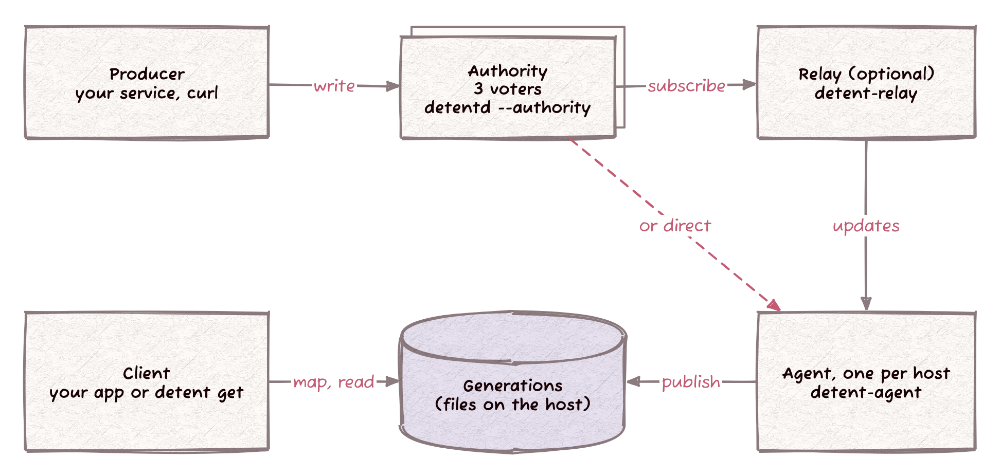

# Detent (C++)

Detent is a C++ runtime-configuration client for namespaced boolean and integer knobs, plus a durable authority daemon (`detentd`) and a host-local managed agent (`detent-agent`). It implements the model in [`justknobs-implementation-spec.md`](justknobs-implementation-spec.md) and adds authenticated transactional publishing, durable Raft consensus, and incremental delivery to hosts.

**New here?** [`QUICKSTART.md`](QUICKSTART.md) covers numeric settings, feature flags, gradual rollouts, group overrides, and per-read fallbacks. The [usage guide](docs/USAGE.md) covers network distribution, configuration, and library examples.

## What this is

- The steady-state read path is process-local and allocation-free: one atomic snapshot load, one lookup, and scalar evaluation. It does not touch the network, disk, or a mutex.
- One background updater thread consumes a file source or a custom poll function, validates off the read path, merges over baked defaults, and atomically publishes a new immutable snapshot.
- Bool knobs support exact-match group overrides and stable SHA-256 percentage rollouts. Integer knobs do not support per-group overrides in v1.
- Missing knobs are errors. CLI overrides (`name=value`) shadow both baked defaults and live data.
- `detentd` is the durable authority: bounded namespace transactions, publisher credentials, and Raft consensus over mutual TLS with a journal on each voter.
- `detent-agent` receives authenticated deliveries from the authority and publishes immutable local generations, which `detent get` maps read-only for shell scripts and other non-C++ callers.

## How Detent fits together



A knob change moves through five actors:

- **Producer**: your service, writing changes as namespaced transactions with `POST /v2/transactions` over HTTPS.
- **Authority**: `detentd --authority authority.json` on three machines, one voter each. The voters replicate with Raft over mutual TLS and keep the journal on their own disks. This is the source of truth.
- **Relay** (optional): `detent-relay`, subscribed to the authority, keeps a durable copy per bundle and serves snapshots and deltas to many agents.
- **Agent**: `detent-agent`, one per host. It receives snapshots and deltas and publishes immutable local generations on disk.
- **Client**: your application, through `detent::Client`, mapping the agent's selected generation and reading in memory. `detent get` is the command-line client.

This is the managed profile, the topology the [production contract](docs/PRODUCTION_CONTRACT.md) targets. [Detent's actors](docs/ACTORS.md) says what each actor does, how, when and where, including ports, files, build options and restart behavior.

## Using it in your own application

### 1. Pull it in (CMake FetchContent)

```cmake
include(FetchContent)
FetchContent_Declare(detent
  GIT_REPOSITORY https://github.com/Kronuz/Detent.git
  GIT_TAG        main)
FetchContent_MakeAvailable(detent)

target_link_libraries(my_app PRIVATE detent::detent)
```

For reproducible builds, replace `main` with the commit you have qualified. A local checkout can also be included with `add_subdirectory()`.

### 2. Write your baked defaults (`just_knobs.json`)

Ship this alongside your binary. Baked defaults are the local fallback before any live snapshot arrives, and they are the place where new knob names are introduced.

```json
{
  "schema_version": 1,
  "knobs": {
    "checkout:killswitch_new_path": { "type": "bool", "default": false },
    "search:max_results": { "type": "int", "default": 25 }
  }
}
```

### 3. Initialize a `Client` and read knobs

```cpp
#include "detent/client.hh"

detent::InitOptions opts;
opts.defaults_path = "/etc/myapp/just_knobs.json";
// Leave source_path/source_poll unset for baked-defaults-only reads.

detent::Client client(std::move(opts));

bool killswitch = client.eval_or_panic("checkout:killswitch_new_path");
std::int64_t max_results = client.get_or_panic("search:max_results");

auto r = client.eval("checkout:killswitch_new_path");
if (r) {
    use(r.value());
} else {
    log(r.error().what());
}

bool enabled = client.eval_or_panic(
    "checkout:killswitch_new_path",
    /*hash_val=*/user_id,
    /*switch_val=*/user_group);
```

Construct one `Client` per process, or use `detent::global::init()` and the `detent::global::*` helpers.

### 4. Pick a distribution mechanism (optional)

One `Client`, three source shapes:

- **None:** baked defaults only.
- **Local file:** set `source_path`, and Detent polls the file for changes.
- **Custom poll:** set `source_poll` to your own function.

File source:

```cpp
opts.source_path = "/var/lib/myapp/live_knobs.json";
opts.poll_interval = std::chrono::milliseconds{200};
```

`source_path` and `source_poll` are mutually exclusive.

### 5. Run the authority

Start a voter with `detentd --authority authority.json` and publish with `POST /v2/transactions`; the [durable authority guide](website/src/content/docs/guides/durable-authority.md) walks through the configuration and a first transaction.

### 6. CLI overrides and testing

```cpp
opts.cli_overrides = {
    "checkout:killswitch_new_path=true",
    "search:max_results=999",
};
```

For tests, bypass files and HTTP entirely:

```cpp
#include "detent/testing.hh"

detent::Snapshot snap;
snap.knobs["checkout:killswitch_new_path"] =
    detent::BoolDef{.default_value = true};
auto guard = detent::testing::TestKnobs(snap).set_thread_local();
```

## Scope vs. the spec

This repository implements the spec's client model and adds a concrete distribution layer:

- `detent`: core client, schema validation, rollout hashing, overrides, publication, health.
- `detentd`: the durable authority daemon.
- `detent-agent`: host-local managed agent that publishes immutable generations for non-C++ readers.
- Python and Rust bindings that wrap the same C++ core.

The wire format remains `schema_version: 1`. Full snapshots, PATCH payloads, and diff responses all validate through the same schema machinery.

## Dependency graph

```text
detent
  |-- atomic-shared-ptr
  |-- sha256 (+ endian)
  |-- char-classify
  |-- strict-stox
  `-- random

detent-agent (exe)
  |-- detent::delivery_config   # managed delivery over TLS
  `-- detent
```

`detent` has no networking dependencies. `detentd` pulls the HTTP framework plus `consensus` for durable Raft. `detent-agent` links the managed delivery libraries; `detent get` links only the local reader.

## Dependencies

All dependencies are fetched with CMake `FetchContent`.

| Library | Role |
|---|---|
| [`atomic-shared-ptr`](https://github.com/Kronuz/atomic-shared-ptr) | Snapshot publication |
| [`sha256`](https://github.com/Kronuz/sha256) (+ `endian`) | Stable rollout-bucket hash |
| [`char-classify`](https://github.com/Kronuz/char-classify) | Knob-name validation |
| [`strict-stox`](https://github.com/Kronuz/strict-stox) | Strict integer parsing |
| [`random`](https://github.com/Kronuz/random) | Full-jitter reconnect backoff |
| [`compressors`](https://github.com/Kronuz/compressors) | zstd/gzip: distribution frame codecs |
| [RapidJSON](https://github.com/Tencent/rapidjson) | Strict JSON parsing |
| [`http`](https://github.com/Kronuz/http) (+ `reactor`, `http-parser`, `radix-router`) | `detentd`'s HTTP service |
| [`consensus`](https://github.com/Kronuz/consensus) | `detentd`'s durable Raft, with journal and completion I/O |
| standalone Asio | Pulled transitively by `http` and `consensus` |

RapidJSON runs in strict mode here. Unknown fields and malformed snapshots are rejected rather than partially applied. It is pinned to upstream commit `24b5e7a8b27f42fa16b96fc70aade9106cf7102f`; the older 1.1.0 release contains a `GenericStringRef` assignment operator that fails to compile with Clang 23.

## Layout

```text
include/
  detent/              Core client and evaluation API
  detent_distribution/ Binary protocol, storage and shared sessions
  detent_distribution_http/ Optional server grammar and owned replies
  detent_relay/        Durable cache and session adapters
  detent_local/        Immutable views and durable generations
  detent_delivery/     TLS client and publication coordinator
  detent_transport/    TLS configuration

src/
  detent/              Core implementation
  detentd/             Authority daemon host
  detent_agent/        Agent host and managed configuration
  detent_authority/    Durable authority, transactions and distribution
  detent_distribution/ Protocol and session implementation
  detent_distribution_http/ Shared server parsing and reply pumping
  detent_relay/        Durable relay core
  detent_local/        Image building and persistence
  detent_delivery/     Session transport and coordinator
  detent_cli/          Shared configuration, logging and daemon lifecycle

tests/                 Matching component suites
examples/
benchmarks/
diagrams/
bindings/
```

## What the source modules build

The core client has no networking dependency. Binary distribution, immutable local views, durable publication and managed TLS delivery are separate targets, so consumers can select the source and storage profile they need. Authority implementation targets remain internal to the daemon and its tests.

Managed agents and relay bundle sources write `"image_format": "paged-v2"` by default, for incremental immutable local publication; `"flat-v1"` selects one self-contained image. Both formats remain readable by the current SDK, and existing flat heads migrate before paged updates. See [writer preference and maintenance](docs/LOCAL_IMAGE_FORMAT.md#writer-preference-and-maintenance) for compaction controls, disk coexistence and reader compatibility.

| Module | Main target | Purpose |
| --- | --- | --- |
| Core client | `detent::detent` | Local lookup, evaluation, defaults and file updates |
| Binary protocol | `detent::distribution` | Canonical codecs, bounded storage, staged frames and shared session lifecycle |
| Distribution server transport | `detent::distribution_http` | Optional strict request parsing and owned HTTP replies |
| Relay HTTP runtime | `detent::relay_http` | Bounded authenticated intake and shared-frame replies |
| Relay host | `detent_relay_host`, `detent-relay` | Optional finite-bundle TLS daemon; [qualification and configuration](docs/RELAY.md) |
| Relay core | `detent::relay` | Durable bundle caches and authorized session adapters |
| Immutable local view | `detent::local_view` | Read mapped durable generations |
| Pinned local export | `detent::local_export` | Encode public definitions from a recovered immutable image |
| Local publication | `detent::local_publication` | Reconcile and publish durable generations |
| Managed transport | `detent::delivery_transport` | Incremental TLS delivery and sessions |
| Managed coordinator | `detent::delivery_coordinator` | Join source delivery to local publication |
| Private source configuration | `detent::delivery_config` | Validate source credentials, scope, TLS and publication limits |

## Binaries and their dependencies

| Binary | Built from | Links | What it is |
|---|---|---|---|
| `detent_demo` | `examples/demo.cc` | `detent` | Baked-defaults-only example |
| `detentd` | `src/detentd/main.cc` | `detent_authority_service` -> authority, `http::http`, `consensus::consensus` | Durable authority daemon |
| `detent-relay` | `src/detent_relay/main.cc` | Relay host, private configuration and bounded TLS distribution | Optional durable fan-out daemon; Stage 5B qualification |
| `detent-agent` | `src/detent_agent/main.cc` | CLI and managed delivery libraries | Host-local managed agent |
| `detent` | `src/detent_agent/main.cc` | CLI and local reader libraries | Host-local `get` reader |
| `test_*` (`tests/detent/`) | `tests/detent/*.cc` | `detent` | Core correctness suite |

## Build

The C++20 standard library must provide `std::jthread` and stop tokens; configuration checks this before building. libc++ 20 and newer expose these normally. FreeBSD 14.4 with base libc++ 19 requires an explicit `-DCMAKE_CXX_FLAGS=-fexperimental-library` when configuring; this opts into libc++'s experimental API/ABI and must also be used by consumers of the public C++ client headers. Prefer a stable implementation when available. See [LLVM 19 documentation](https://releases.llvm.org/19.1.0/projects/libcxx/docs/UsingLibcxx.html) and [LLVM 20 release notes](https://libcxx.llvm.org/ReleaseNotes/20.html).

The authority integration tests require Python 3, Bash, curl, and the OpenSSL command-line tool on `PATH`. Bash is not part of FreeBSD's base system; install it before running the tests. These tools are test dependencies and are not required by the running daemons.

```sh
cmake -B build
cmake --build build -j
ctest --test-dir build --output-on-failure
./build/examples/detent_demo
```

`DETENT_BUILD_AUTHORITY` defaults to `ON`. Set `-DDETENT_BUILD_AUTHORITY=OFF` to skip `detentd` and its HTTP and consensus dependency chain. `DETENT_BUILD_PYTHON` and `DETENT_BUILD_RUST` default to `OFF`.

### Binary size

Measured on macOS/arm64 for `detent-agent`:

| Build | Size |
|---|---|
| Unset `CMAKE_BUILD_TYPE` | 1.15 MB |
| `Release` | 295 KB |
| `Release` + `strip -x` | 242 KB |

Most of the difference comes from RapidJSON and ordinary C++ runtime support.

### Running detentd

```sh
./build/src/detentd --authority authority.json
```

`detentd` listens on port `8317` unless `--port` says otherwise, and serves the authority named by `--authority` (or the `authority` field of `detentd.json`). `detentd.json` lives in the same platform config directory as `agent.json` and accepts `authority`, `port`, `reactors`, `runtime_dir` and the logging fields; relative paths are resolved against the config file. `--config PATH` selects another file. CLI arguments override `DETENTD_*` environment variables, which override config. `detentd --status` reports health over plain HTTP, or over HTTPS when the authority's publisher uses TLS. See [the durable authority guide](website/src/content/docs/guides/durable-authority.md) and [the `detentd` reference](website/src/content/docs/reference/cli/detentd.md).

### Running detent-agent

With a managed configuration (see [managed authority delivery](docs/USAGE.md#managed-authority-delivery)) and a running authority:

```sh
./build/src/detent get search:max_results --managed managed.json
./build/src/detent-agent --status --managed managed.json
kill -TERM "$(./build/src/detent-agent --status --managed managed.json | awk '/^running/ {gsub(/[^0-9]/, "", $3); print $3}')"
```

`get` starts the agent when no durable generation is present. With neither `--managed` nor `--generation-dir` (or `managed_path` and `generation_dir` in `agent.json`), `detent get` and `detent-agent` exit with `no source configured`. For persistent settings, put `agent.json` in the platform's user config directory (`~/.config/detent` on Linux/FreeBSD, `~/Library/Application Support/Detent` on macOS):

```json
{"managed_path": "managed.json", "generation_dir": "agent-state"}
```

`--config PATH` selects another config file. Optional `defaults.json` beside the config supplies local fallback knobs; `--defaults PATH` selects another file, and `--default VALUE` provides a per-read fallback.

Runtime files use `$XDG_RUNTIME_DIR/detent`, falling back to a private `detent-<uid>` directory under the system temporary directory. `runtime_dir`, `--runtime-dir`, or `DETENT_RUNTIME_DIR` selects another directory. Stop the agent to apply changed startup settings. See [the usage guide](docs/USAGE.md#persistent-agent-configuration) for system config locations and precedence.

## Language bindings

Enable bindings explicitly:

```sh
cmake -B build -DDETENT_BUILD_PYTHON=ON -DDETENT_BUILD_RUST=ON
cmake --build build -j
```

- **Python** (`bindings/python/`, pybind11): wraps `detent::Client` and raises `detent.DetentError` on construction or read failures.
- **Rust** (`bindings/rust/`, `cxx`): wraps `detent::Client` behind an opaque handle and returns `Result<T, DetentError>`.

Python example:

```python
import detent

client = detent.Client(
    "/etc/myapp/just_knobs.json",
    source_path="/var/lib/myapp/live.json",
)
client.eval("payments:new_processor", hash_val="user-42")
client.eval("checkout:new_flow", switch_val="beta_testers")
client.get("search:max_results")
client.health()
```

Rust example:

```rust
let client = detent::Client::new(
    "/etc/myapp/just_knobs.json",
    Some("/var/lib/myapp/live.json"),
    vec![],
    200,
)?;
client.eval("payments:new_processor", Some("user-42"), None)?;
client.eval("checkout:new_flow", None, Some("beta_testers"))?;
client.get("search:max_results", None)?;
client.health();
```

## Testing

CTest registers component and process tests for the enabled build profiles. Use `ctest --test-dir build -N` to list the exact set for your configuration.

1. Core tests cover schema validation, rollout vectors, evaluation, overrides, file updates and concurrency.
2. Authority tests cover transactions, durable storage, authenticated consensus, restart and failure recovery, bounded distribution, subscription admission and large-state idling.
3. Protocol, local-view and delivery tests cover binary validation, mapped generations, original IO settlement, publication reconciliation and exact source feedback.
4. Process fixtures start real daemons, exercise HTTP and local readers, and stop or kill tracked processes.

## Benchmarks

Benchmarks in `benchmarks/` build by default. Measured output on one 14-core arm64 development machine:

| Benchmark | What it measures | Command | Result |
|---|---|---|---|
| `detent_read_bench` | Steady-state read throughput | `detent_read_bench 4 2000000` | 6.71M ops/sec (149.1 ns/op) |
| `detent_hash_bench` | `stable_bucket()` only | `detent_hash_bench 5000000` | 5.05M calls/sec (198.2 ns/call) |
| `detent_update_bench` | Parse + validate + merge for a 100-knob snapshot | `detent_update_bench 200000 100` | 28.6K updates/sec (35.0 us/update) |

### Security boundary

`detentd` authenticates publishers with bearer tokens, voters with mutual TLS and a certificate pin, and bounds every admission layer; see [Security](website/src/content/docs/operations/security.md). Host-local reads trust the host.

### Consistency model

Within one authority group, transactions commit in a single replicated log and the authority assigns revisions.

## Production readiness: honest checklist

| Area | Status | Detail |
|---|---|---|
| Correctness (client) | **Proven** | 8 automated suites, including golden hash vectors, precedence rules, and concurrency stress |
| Correctness (host-local agent) | **Proven** | Managed-process and system suites: delivery, restart, failover and reads |
| Linux sanitizer coverage | **Proven on Linux** | ASan/UBSan and TSan run clean across the full suite (multiple stress repetitions) |
| Real network conditions | **Not done** | Current measurements are loopback-only |
| Soak/long-run stability | **Not done** | No multi-hour or multi-day validation documented |


System-wide deployment: see [System services](docs/SERVICES.md) for service accounts, directory ownership, supervision, and logging on Linux, FreeBSD, and macOS.

The shell reader is `detent get NAME`. Both daemons run directly in the foreground, accept `--daemonize` for user background operation, and provide read-only `--status`. Send SIGTERM to stop a user daemon; supervised services use their service manager. The reader launches a sibling `detent-agent` binary, or finds it on `PATH` when invoked by name.

### Rollouts by group

Boolean overrides may be `true` or `false`, or an object containing only `rollout_pct` (an integer from 0 to 100):

```json
"overrides": {"employees": true, "beta": {"rollout_pct": 50}, "production": {"rollout_pct": 5}}
```

A matching group rollout replaces the knob-wide rollout percentage and uses the same hash bucket. Without a hash, it returns the knob's default. Unknown groups use the knob-wide rollout. Boolean overrides still force their value. The behavior is shared by C++ clients, language bindings, and `detent get`. PATCH replaces a complete knob definition, including all its groups.

Daemon diagnostics: see [Logging](docs/LOGGING.md) for verbosity, terminal colors, service configuration, and measured footprint. The logger is linked only into daemon executables.

Large-state architecture and implementation gates: see the [Validated Architectural Blueprint](docs/VALIDATED_ARCHITECTURE.md) and [Scaling Detent](docs/SCALING.md), including the measured 100,000/500,000-knob baseline and the Xapiand compatibility plan. The blueprint is a source-reviewed, conditional architecture approval; consensus correctness, durability, and fleet capacity still require the specified validation gates.

The [production operating contract](docs/PRODUCTION_CONTRACT.md) states topology, retry retention, staleness, restore and upgrade boundaries. Current work and reproduced regression evidence are tracked in the [implementation record](docs/IMPLEMENTATION.md).

The durable authority profile provides bounded namespace transactions, producer retry sessions, authenticated multi-voter consensus and completion-based persistence. Managed agents recover immutable local generations and can use polling or publication-aware subscriptions. Startup recovery precedes live admission. See [the authority architecture](docs/AUTHORITY_ARCHITECTURE.md), [managed delivery](docs/DELIVERY_INTEGRATION_ARCHITECTURE.md) and [implementation status](docs/IMPLEMENTATION.md) for APIs, qualification and the remaining relay, incremental publication and fleet work.
