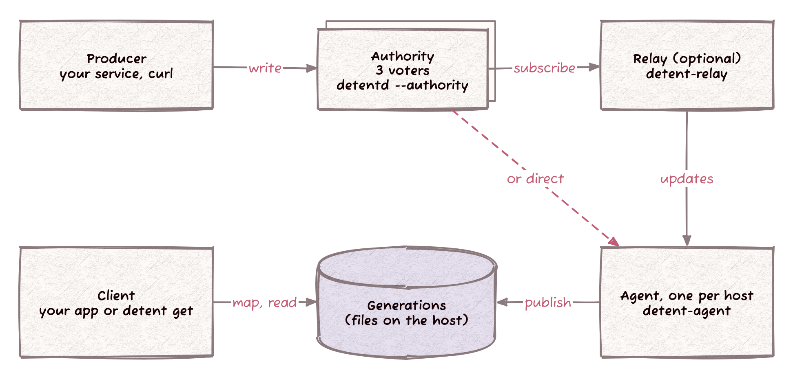
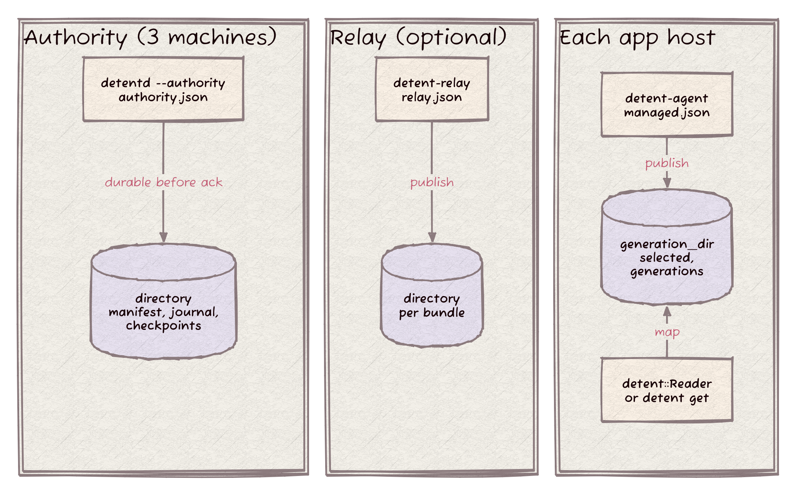
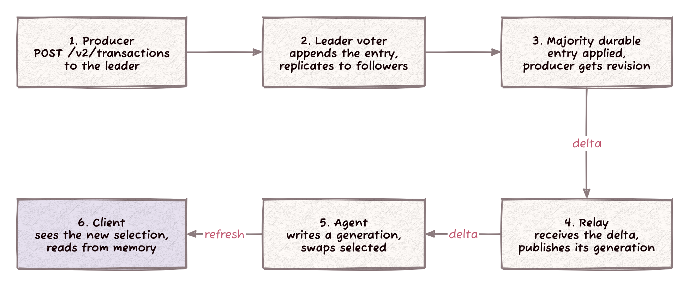

> Status: CURRENT (2026-11-03) Reference for Detent's runtime actors, checked against the source on `main`.

# Detent's actors

Five actors move a knob change from the service that writes it to the process that reads it: the **producer**, the **authority**, the optional **relay**, the **agent** and the **client**. This page says what each one does, how it talks and stores data, when it acts, and where it runs.



Detent has two delivery profiles:

1. **Managed.** Producer, authority, relay, agent and client, as drawn above. This is the topology the [production operating contract](PRODUCTION_CONTRACT.md) targets: one regional authority of three voters, durable relays and one agent per host.
2. **Classic.** `detentd` without `--authority` is a plain HTTP distributor that clients poll for JSON. The code and the service guide call it the legacy profile. It is still built by default and still supported; see [The classic profile](#the-classic-profile).

## Terms

Each role has one name in this page, and the names match the code.

| Term | Means | Binary |
| --- | --- | --- |
| Producer | A service that writes knob changes to the authority | Yours; any HTTPS client |
| Authority | The replicated source of truth, made of voters | `detentd --authority` |
| Voter | One member of the authority, on its own machine and disk | `detentd --authority` |
| Relay | Optional fan-out between the authority and agents | `detent-relay` |
| Agent | The per-host process that writes local generations | `detent-agent` |
| Client | An application process reading knobs in memory | Your app, linking `detent::Client` |
| Distributor | The classic, legacy HTTP server | `detentd` |

A **generation** is one immutable, complete copy of the knob state on disk. An agent or relay *publishes* a generation by writing it and then atomically replacing a small descriptor file named `selected`. "Daemon" names no role: voters, relays and agents are all daemons. The configuration keys `publisher_tls`, `publisher_bind` and `publisher_name` belong to the authority's producer listener, and `publisher_user` names the account trusted to publish generations; neither is a separate actor.

## Where each actor runs



| Actor | Runs on | Binary | CMake option | Configuration | Durable state | Source |
| --- | --- | --- | --- | --- | --- | --- |
| Producer | Anywhere that reaches the authority | Yours | None | Yours | Its unacknowledged requests | None |
| Authority | Three machines, one voter each | `detentd` | `DETENT_BUILD_DISTRIBUTOR=ON` and `DETENT_BUILD_AUTHORITY=ON` | `authority.json`, passed with `--authority` | The `directory` named in `authority.json` | `src/detent_authority/`, `src/detentd/main.cc` |
| Relay | Between the authority and agent hosts | `detent-relay` | `DETENT_BUILD_RELAY=ON` | `relay.json` | One directory per bundle | `src/detent_relay/` |
| Agent | Every application host | `detent-agent` | Always built; managed delivery needs `DETENT_BUILD_MANAGED_AGENT=ON` | `agent.json` (public), `managed.json` (private) | `generation_dir` | `src/detent_agent/`, `src/detent_delivery/`, `src/detent_local/` |
| Client | Every application host, beside the agent | Your app; `detent` for `detent get` | Always built | `InitOptions` in code; `agent.json` for `detent get` | None | `src/detent/`, `src/detent_local/` |

## Producer

**What.** A producer writes knob changes. Detent ships no producer binary: it is your service, a deployment tool or `curl`, holding a bearer token from the authority's `credentials` list.

**How.** Every request is an HTTPS `POST` with `Authorization: Bearer TOKEN` and the authority identity (`cluster`, `group`, `epoch`) in its JSON body. The producer opens a session with `POST /v2/open`, writes with `POST /v2/transactions` and ends with `POST /v2/close`. A transaction changes keys in one namespace atomically; it carries the session `generation`, a contiguous `sequence` and its `operations`. `POST /v2/read` and `POST /v2/result` give quorum reads and look up a past outcome. A credential with `"publish": false` gets `403` from the three write endpoints. The [authority API](../website/src/content/docs/reference/http-api/authority.md) lists the fields.

**What it stores.** The authority keeps the last 256 results of a session, so the producer keeps the exact request until it learns the outcome. On an unknown outcome it retries with the same generation, sequence and contents; a new sequence can apply the change twice.

**When.** It opens a session before its first write and reopens one after a restart. Each open fences the previous generation of that producer.

**Where.** Anywhere with network access to the authority's producer listener, port `8317` unless `--port` says otherwise. A listener on a non-loopback address requires `publisher_tls`.

## Authority

**What.** The authority is the source of truth. It orders transactions, assigns revisions, keeps the state durable on a majority of voters, and serves snapshots and deltas to relays and agents.

**How.** One `detentd --authority authority.json` process per voter. Each voter has two listeners:

1. The producer listener, on `publisher_bind` (loopback by default) and `--port` (8317 by default). It serves `/v2/open`, `/v2/close`, `/v2/transactions`, `/v2/read`, `/v2/result`, `POST /v2/distribution` (one-shot poll), `POST /v2/distribution/session/open`, `/next` and `/close` (long-poll subscription), and `GET /v1/health`.
2. The peer listener, on this voter's `host` and `port` from the `voters` list. Voters replicate over mutually authenticated TLS (`peer_tls`), and each voter pins every peer's certificate by its SHA-256 fingerprint.

The configuration either omits `voters` (a single voter, for development) or lists a fixed, odd set of 3, 5 or 7 voters with `node` naming the local one. Membership does not change in place. Only the leader commits: it groups up to 64 producers' transactions per log entry, waits up to 5 ms to fill a group, and answers a producer once a majority has the entry on disk and the leader has applied it. Followers do not forward producer requests.

**What it stores.** The `directory` from `authority.json`, resolved relative to that file, holds a `manifest`, the journal and checkpoints. The authority creates the directory with mode `0700`; its parent must exist. `authority.json` must be a regular file owned by the service user or root, with no access for others and no group write.

**When.**

1. First start, empty directory: there is no `manifest`, so the voter creates a new store.
2. Restart: the `manifest` exists, so the voter recovers the journal and checkpoint, replays every committed entry, and only then admits requests.
3. Steady state: the leader commits groups of transactions; checkpoints start once the retained log reaches half its configured limits, and old journal segments go after a checkpoint is published.
4. A voter that falls behind catches up from the leader's log, or from a snapshot when the log has been compacted.

**Where.** The authority tier: one machine per voter, each with its own disk. Build `detentd` with `-DDETENT_BUILD_DISTRIBUTOR=ON -DDETENT_BUILD_AUTHORITY=ON`; without `DETENT_BUILD_AUTHORITY`, `--authority` fails at startup. `authority.json` has no default location: pass `--authority PATH`, or set `"authority"` in `detentd.json`. The PID file is `detentd-<port>.pid` in the runtime directory. See [authority architecture](AUTHORITY_ARCHITECTURE.md) and [authority transport](AUTHORITY_TRANSPORT.md).

## Relay

**What.** The relay is optional fan-out. It takes one subscription per configured bundle from the authority and serves many agents from its own durable copy, so the authority sees one subscriber per bundle instead of one per host.

**How.** Upstream, each bundle's `source` file uses the [managed delivery configuration](USAGE.md#managed-authority-delivery). Relay sources always subscribe (`/v2/distribution/session/*`); an explicit `"delivery_mode": "poll"` is rejected. Downstream, the relay listens with TLS on `127.0.0.1:8318` by default and serves only `POST /v2/distribution/session/open`, `/next` and `/close`, plus `GET /v1/health`. A downstream bearer token in `credentials` grants a list of bundle indices. Each request gets either a delta from the relay's cache of recent updates (64 edges and 64 MiB per bundle by default) or a full snapshot.

**What it stores.** Each bundle has its own `directory`, holding durable generations in the same format as an agent's, with mode `0700` on the directory and `0600` on its files.

**When.**

1. First start: a bundle with `"mode": "fresh"` provisions an empty store. Change it to `"existing"` (or remove it) before the next restart.
2. Startup: the relay recovers every bundle store and authenticates every upstream source. Only then does health report ready.
3. Steady state: each upstream update becomes a new durable generation and a cache entry. A cache miss or gap produces a snapshot for the agent.
4. Restart: the relay resumes from each bundle's last durable selection.

**Where.** Between the authority and the agent hosts. Build with `-DDETENT_BUILD_RELAY=ON` (off by default; requires OpenSSL 3.0). The configuration is `relay.json` in the user configuration directory, or the system one with `--system`; unlike `agent.json` and `detentd.json`, there is no fallback from the user directory to the system directory. System bundle directories go under `/var/lib/detent-relay` (Linux) or `/var/db/detent-relay` (macOS, FreeBSD). The PID file is `relay.pid` in the runtime directory. See [the relay guide](RELAY.md).

## Agent

**What.** One agent per host receives snapshots and deltas and publishes immutable local generations, so every process on the host reads the same state without its own network connection.

**How.** `detent-agent --managed managed.json` connects to one authority endpoint, a pool of up to eight authority endpoints (`authority_endpoints`), or one relay, always over verified TLS with a bearer token. `delivery_mode` selects how it asks:

1. `poll` (the default): `POST /v2/distribution` every `poll_interval_ms` (200 ms by default).
2. `subscription`: `POST /v2/distribution/session/open`, then long-polls `/next`. An agent behind a relay must set this explicitly.

Each update carries a cursor (authority identity, scope and revision). The agent validates it against the generation it already has, builds the next generation, syncs it, and atomically replaces `selected`. A failed update leaves the previous selection in place.

**What it stores.** The `generation_dir` holds:

| File | Content |
| --- | --- |
| `selected` | The 176-byte `DTSELECT` descriptor naming the active generation, its length, SHA-256 and cursor |
| `generation-<id>.image` | The image; for `paged-v2`, a root that references packs |
| `generation-<id>.descriptor` | That generation's own descriptor |
| `generation-<id>.lease` | The lock file readers hold so cleanup cannot delete a generation in use |
| `generation-<id>.read` | `paged-v2` prepared metadata: a 192-byte record that lets clients attach without a full scan |
| `segment-<id>.pack`, `segment-<id>.owner` | `paged-v2` page packs and their ownership records |

`image_format` chooses `paged-v2` (the default) or `flat-v1` (one self-contained image). Readers handle both. See [the local image format](LOCAL_IMAGE_FORMAT.md).

**When.**

1. First start: run once with `--initialize-managed` on an empty directory. The first update is a full snapshot.
2. Startup: the agent opens the existing store, recovers the selected generation and, for `paged-v2`, its prepared metadata, then reports ready. Recovery has 180 seconds.
3. Steady state: it asks for updates, publishes each one, and compacts `paged-v2` packs every 60 seconds (`compaction_interval_ms`).
4. Restart: it resumes from the cursor of its selected generation. The upstream sends a delta when its retained history covers that cursor, and a full snapshot otherwise.
5. Upstream down: it keeps the last selection and retries with backoff.

**Where.** Every application host. `detent-agent` is always built; `--managed` needs `DETENT_BUILD_MANAGED_AGENT=ON`, which is the default. The public `agent.json` (in `~/.config/detent` on Linux and FreeBSD, `~/Library/Application Support/Detent` on macOS, or the system directory with `--system`) can name `managed_path` and `generation_dir`. The private `managed.json` holds the token and has no default path. `generation_dir` defaults to `agent` under the user state directory, or `/var/lib/detent-agent` (Linux) and `/var/db/detent-agent` (macOS, FreeBSD) for system services. `agent.pid` and `agent.log` live in the runtime directory.

Without `--managed`, `detent-agent` runs the legacy profile instead: it polls a classic distributor and writes `snapshot.shm`. See [The classic profile](#the-classic-profile).

## Client

**What.** The client is the application process. It reads knobs in memory: no network, disk or lock on a read.

**How.** A C++ application sets `InitOptions::read_source` to `detent::local::make_managed_read_source(generation_dir, publisher_uid)` from `detent::local_client`. The client checks that the generation comes from `publisher_uid` in a directory whose ancestry only trusted accounts can change, takes a shared lock on the selected generation's `.lease`, maps the image read-only and reads from the mapping. A background thread looks at `selected` every 200 ms and swaps to a newer generation; a read view in use keeps its generation until it is released. Baked defaults (`just_knobs.json`) cover keys the generation lacks.

`detent get NAME` is the command-line client. With `--generation-dir` or a configured `generation_dir`, it reads the selected generation directly, even while the agent is stopped. A user-mode read starts a missing agent when a managed configuration is present; `--system` never starts one.

**What it stores.** Nothing. The generations belong to the agent.

**When.**

1. Startup: attach to the selected generation; with none yet, read baked defaults.
2. Steady state: reads are memory lookups; refresh happens on the background thread.
3. Agent restart: the client keeps its mapped generation and picks up the next one when `selected` changes.

**Where.** The same host as its agent. Link `detent::detent` and `detent::local_client`; both are always built. The `detent` binary is the CMake target `detent-reader`.

## From a write to a read



1. The producer sends `POST /v2/transactions` to the leader voter.
2. The leader appends the entry to its journal and replicates it to the followers.
3. Once a majority has the entry on disk, the leader applies it, assigns the revision and answers the producer.
4. The relay, subscribed to the leader, receives a delta and publishes its own durable generation.
5. The agent receives the delta from the relay (or straight from the leader without a relay), writes a new generation and replaces `selected`.
6. The client's refresh thread sees the new `selected`, maps the generation and serves reads from it.

## Restart and first contact

| Actor | Empty store | Restart |
| --- | --- | --- |
| Authority voter | No `manifest`: creates a new store | Recovers the journal and checkpoint, replays committed entries, then admits requests |
| Relay bundle | `"mode": "fresh"` provisions it | Recovers the last durable selection; ready after every bundle authenticates upstream |
| Agent | `--initialize-managed` once; first update is a snapshot | Recovers `selected`; asks for a delta from its cursor |
| Client | Reads baked defaults | Re-attaches to `selected` |

Agents keep their last durable generation while anything upstream is down, and clients keep reading it. The data gets older; reads keep working.

## Build options

| Option | Default | Builds |
| --- | --- | --- |
| `DETENT_BUILD_DISTRIBUTOR` | `ON` | `detentd` (classic distributor; also needed for the authority) |
| `DETENT_BUILD_AUTHORITY` | `OFF` | `--authority` in `detentd`; needs `DETENT_BUILD_DISTRIBUTOR` |
| `DETENT_BUILD_RELAY` | `OFF` | `detent-relay`; needs OpenSSL 3.0 |
| `DETENT_BUILD_MANAGED_AGENT` | `ON` | `--managed` support in `detent-agent` |
| `DETENT_BUILD_TESTS`, `DETENT_BUILD_EXAMPLES`, `DETENT_BUILD_BENCHMARKS` | `ON` | Tests, examples, benchmarks |
| `DETENT_BUILD_PYTHON`, `DETENT_BUILD_RUST` | `OFF` | Language bindings |

`detent-agent`, `detent`, `detent::detent`, `detent_http` and `detent::local_client` have no option; they are always built. A build with every actor:

```sh
cmake -B build -DDETENT_BUILD_AUTHORITY=ON -DDETENT_BUILD_RELAY=ON
cmake --build build -j
```

## Default locations

| Directory | User (Linux, FreeBSD) | User (macOS) | `--system` |
| --- | --- | --- | --- |
| Configuration | `$XDG_CONFIG_HOME/detent`, else `~/.config/detent` | `~/Library/Application Support/Detent` | `/etc/detent`; FreeBSD `/usr/local/etc/detent`; macOS `/Library/Application Support/Detent` |
| State | `$XDG_STATE_HOME/detent`, else `~/.local/state/detent` | `~/Library/Application Support/Detent/state` | `/var/lib/detent`; macOS and FreeBSD `/var/db/detent` |
| Runtime (PID, log, `snapshot.shm`) | `$XDG_RUNTIME_DIR/detent`, else `detent-<uid>` in the temporary directory | Same | `/run/detent`; macOS and FreeBSD `/var/run/detent` |

`agent.json` and `detentd.json` are looked up in the user configuration directory first and in the system one when the user file is absent. Keep durable directories out of the runtime directory, which is cleared at boot. [System services](SERVICES.md) covers service accounts and the systemd, launchd and rc.d templates.

## The classic profile

The classic profile is the original, simpler path. The code calls it legacy (`detentd` refuses to mix `--authority` with "legacy multicast", and `detent-agent` describes itself as a "managed or legacy" daemon). It has no authentication or TLS.

1. **Distributor.** `detentd` without `--authority` serves `PUT`, `PATCH` and `GET /v1/snapshot` and `GET /v1/health` on port 8317. It writes the whole snapshot to `persist_path` (`snapshot.json` in the state directory) on every accepted write and reloads it at startup. `--cluster` joins a classic Raft group over `cluster::Bus` UDP multicast; see `src/detentd/CLUSTERING.md`.
2. **Producer.** Anything that sends `PUT` or `PATCH /v1/snapshot`.
3. **Client.** `detent::Client` with `detent_http::make_http_poll_source()` polls `GET /v1/snapshot` with `If-None-Match` and `X-Detent-Base-Version`, and gets `304`, a diff or the full body.
4. **Legacy agent.** `detent-agent` with `source_address` runs one polling client and copies each accepted snapshot into `snapshot.shm` under a seqlock. `detent get` without a generation directory maps that file and starts a user agent on demand.

The managed and classic profiles share the `detentd` binary and its default port, so one process runs one profile.
