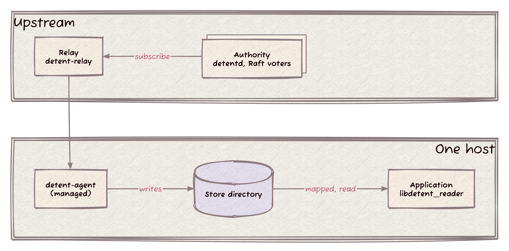
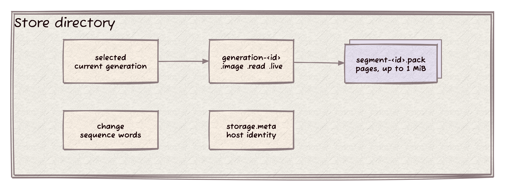
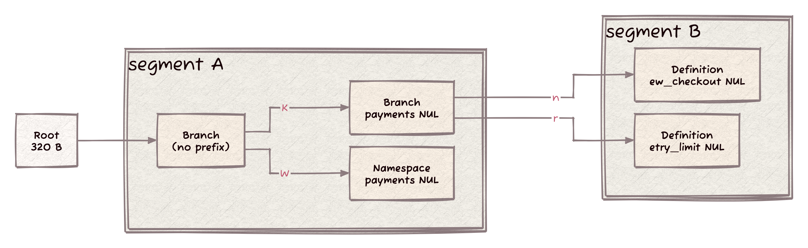
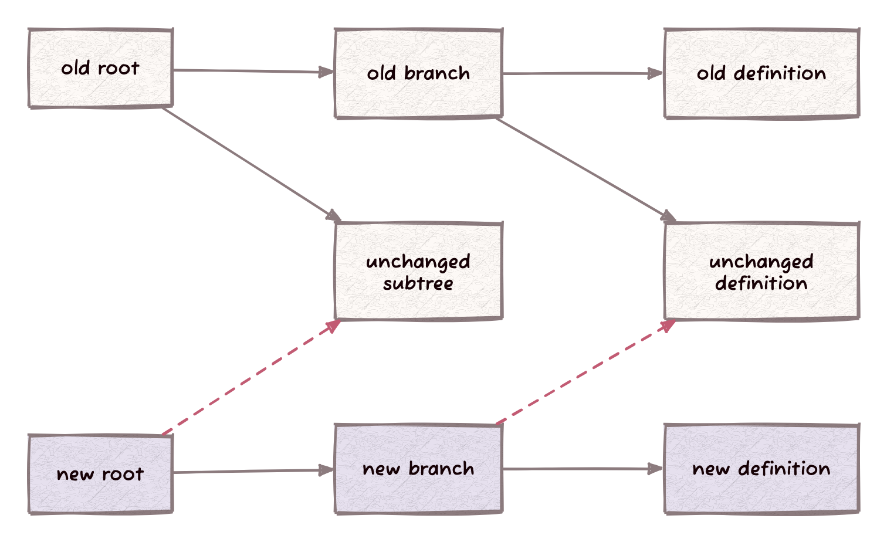
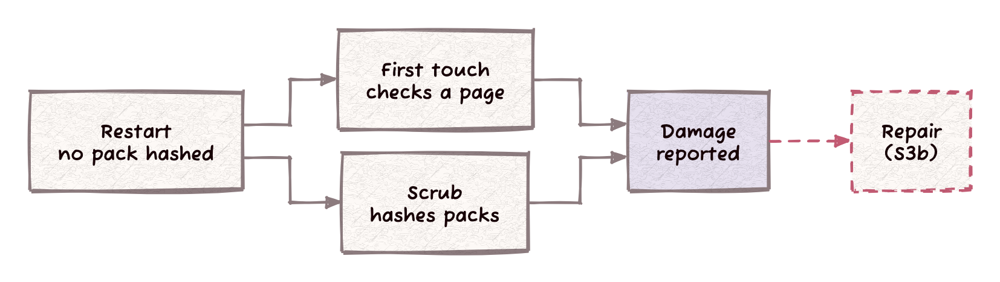

> Status: CURRENT (2026-11-04) End-to-end guide to how Detent delivers and reads knobs, checked against `main` at `Detent:5475baf` and the ledgers in [status/](status/). Workstream: how-it-works.

# How Detent works

A knob change starts at a producer, lands in the authority, travels through a relay to one agent per host, and ends as immutable files on that host's disk. Applications map those files and read knobs straight from them, with no request to anyone.

This page follows that path in seven steps: the actors, the store on disk, the trie inside it, reading, updating, seeding from an image, and restart. Each step says what runs on `main` today and marks what is designed but not built.

## What exists today

| Piece | State | Where it is recorded |
| --- | --- | --- |
| Authority, relay, managed agent | On `main` | [ACTORS.md](ACTORS.md) |
| The agent store: packs, `.read`, `.live`, `.lease`, the `selected` table, `change` | On `main`; until step S6 the table has one entry, named after the configured scope, which holds every namespace | [status/namespace-s7.md](status/namespace-s7.md) "Wiring", [change-file.md](mechanisms/change-file.md), [trusted-restart.md](mechanisms/trusted-restart.md) |
| Trusted restart, first-touch checks, the paced scrub | On `main` (namespace step S3) | [status/namespace-s3.md](status/namespace-s3.md) |
| Damaged-pack repair | In progress (step S3b) | [status/namespace-s3.md](status/namespace-s3.md), "Blocked on" |
| `libdetent_reader`, the lock-free reader core | Built on branch `reader/s6`, not on `main` (reader step S6) | [design/reader.md](design/reader.md), [status/reader-s5-s6.md](status/reader-s5-s6.md) |
| One table entry and one `change` slot per namespace | Designed (namespace delivery D8, step S6) | [design/namespace-delivery.md](design/namespace-delivery.md) |
| Compacted blocks of history | Designed (namespace delivery D6, `Detent:814b605`), not built | [design/namespace-delivery.md](design/namespace-delivery.md) |
| `detent-image` and seeded stores | Designed (namespace delivery D9, step S9), not built | [design/namespace-delivery.md](design/namespace-delivery.md) |
| Removal of the unmanaged agent and its shared-memory copy | Removed (legacy wave 2, step G) | [status/legacy-wave2.md](status/legacy-wave2.md) |
| Removal of the Client's file and poll sources | In progress (legacy wave 2, step H) | [status/legacy-wave2.md](status/legacy-wave2.md) |

## 1. The actors

**The authority** decides what the knobs are. It is `detentd --authority authority.json`, one process per voter: a single voter for development, or a fixed set of 3, 5 or 7 that replicate a Raft log and answer a producer once a majority has the entry on disk ([ACTORS.md](ACTORS.md)). It keeps the last 4,096 transactions, up to 16 MiB, in memory to serve deltas (`src/detent_authority/change_history.hh:8`).

**The relay** is optional fan-out. `detent-relay` takes one subscription per configured bundle from the authority and serves many agents from its own durable copy, so the authority sees one subscriber per bundle instead of one per host. Each bundle keeps 64 recent updates (64 MiB) as exact deltas (`include/detent_relay/configuration.hh:8-9`).

**The agent** is one managed `detent-agent` per host, started with `--managed managed.json --generation-dir DIR`. It is the only writer of its store directory and holds `owner.lock` exclusively for the store's whole life ([change-file.md](mechanisms/change-file.md)).

**Applications** read knobs from that directory through `libdetent_reader`, one reader core with a C ABI; in the design, C++, Rust and Python wrap it and `detent get` calls it ([reader.md](design/reader.md) D1). Until reader step S6 lands, applications read through `detent::Client` with `make_local_read_source` (`include/detent_local/client_source.hh:31`), over the same files.

**Legacy wave 2 removed the unmanaged agent.** It kept one `detent::Client` in its own memory, polled a file or the classic HTTP distributor, and copied the whole snapshot into a shared-memory region capped at 4 MiB (formerly `src/detent_agent/agent.hh` and `src/detent_agent/shm_format.hh`). That is a second copy of data the managed store already gives every process through file mappings, it had no path to authority data, and the classic distributor it polled is already removed. The owner ruled to drop it (decision 7 of the wave 2 ledger). Step G deleted it, and `detent-agent` and `detent get` now exit with `no source configured` when no managed source is set.

## 2. The store on disk

The store is one directory. A *generation* is one complete, immutable copy of the knob state, made of a few small records and the packs they reference.

| File | What it holds | Size |
| --- | --- | --- |
| `segment-<id>.pack` | A segment: pages packed end to end | At most 1 MiB (`include/detent_local/paged_layout.hh:15`) |
| `segment-<id>.owner` | The segment's owner record (`DTSGOWN2`): id, length, SHA-256 | 128 B |
| `generation-<id>.image` | The root of the trie | 320 B |
| `generation-<id>.read` | Reader metadata (`DTREAD02`): exact counts, bound to the generation and the root checksum, with a trailing SHA-256 | 192 B |
| `generation-<id>.live` | Per segment, the live page and byte counts; the segment list; the override histogram; a trailing SHA-256 | 1,152 B plus 72 B per segment plus 32 B |
| `generation-<id>.lease` | Empty; a reader holds it shared while it reads the generation | Empty |
| `selected` | The table (`DTTABLE1`): the store's profile and, per namespace, its cursor, `change` slot, generation, ordinal, and the SHA-256 of its root and `.read` | 96 B plus 137 B and the name per entry |
| `change` | Sequence words that tell readers `selected` moved | 8 B per word |
| `owner.lock` | The agent's exclusive lock | Empty |

Sizes come from `include/detent_local/ownership.hh:8-9`, `src/detent_local/store_table.cc`, [LOCAL_IMAGE_FORMAT.md](LOCAL_IMAGE_FORMAT.md) and [trusted-restart.md](mechanisms/trusted-restart.md). Every name is derived from what it holds (D8), and only `AgentStore` writes the directory.

**Files are immutable.** A new generation is new files: new packs for the pages that changed, a new root, new `.read`, `.live` and `.lease`. Packs that did not change are not copied; the new generation references them where they are. Two names are the exception: `selected`, replaced by an atomic rename, and `change`, whose words are incremented in place and which only grows. After each publication `AgentStore::collect()` removes every generation the table does not reach, `.lease` first under an exclusive lock, and every segment no remaining `.live` names; a generation whose `.lease` a reader holds stays, and the collection runs again after a backoff.

**The `change` file** is an array of 8-byte words. Word 0 is the store word, incremented after every replacement of `selected`. Word 1 + *slot* is one table entry's sequence, incremented after every replacement that changes that entry. An entry takes its slot with its namespace's first publication: a fresh store's file is 8 bytes, and 16 once the agent's one entry is published ([change-file.md](mechanisms/change-file.md)).

**`.read` and `.live`** are what make a restart cheap. `.read` carries the counts a reader needs before it touches a page. `.live` carries what a full walk of the pages would otherwise compute: which segments are live and how full, and the override histogram. Both are written and synced with the generation's other files before `selected` names it.

## 3. The trie

Inside a generation, knobs live in a **canonical, path-compressed byte-radix trie**: radix 256, one child per possible next byte, with runs of shared bytes compressed into a prefix on one node ([dense pages](mechanisms/dense-pages.md)). Canonical means the same knobs always make the same trie, whatever their update history.

**Keys.** Two kinds, both terminated by NUL so no key is a prefix of another (`src/detent_local/paged_layout.cc:84-120`):

- A namespace watermark: `W namespace NUL`.
- A definition: `K namespace NUL local-name NUL`.

The diagram shows trie nodes and child labels. Dense pages hold connected groups of these nodes. Looking up `payments:new_checkout` walks `K payments NUL new_checkout NUL`; an edge either reaches another node in the same page or follows a reference to another page. Pages of one generation can sit in different segments.

**Dense pages.** DTPAGE03 has this layout (`include/detent_local/paged_layout.hh`):

| Part | Size | What it holds |
| --- | --- | --- |
| Header | 64 B | Length, external-child count, node count, key count, height and page digest |
| Nodes | Variable | Connected trie nodes in preorder, compressed prefixes, sorted labels, inline slots and leaf bodies |
| External-child content | 48 B each | Length, key count, height and digest, with reserved bytes |
| External-child placement | 20 B each | Segment identity and aligned offset |

A **reference** is one 68-byte child entry everywhere: its 48-byte content (digest 32, key count 8, length 4, height 1, zero 3) and its 20-byte placement (segment identity 16, offset 4). A page stores the two halves in its tables; the root stores them side by side. A page occupies 79 bytes to 64 KiB, starts on an 8-byte boundary and fits inside one segment. The packer groups nodes toward a 4 KiB target. The 320-byte DTROOT03 holds the cursor, profile, totals and root-page reference ([dense pages](mechanisms/dense-pages.md)).

**Kinds.** A *Branch* node has at least two children. A *Definition* node holds its value and overrides. A *Namespace* node holds the 8-byte revision watermark. The largest definition, 256 overrides with 128-byte keys, occupies 33,816 body bytes and fits in one page.

**One digest per page.** SHA-256 covers the page header outside its digest field, the nodes and the external-child content. Child placement is outside that digest. The root-page digest commits to the complete state; an empty state uses SHA-256 of `detent.local.empty.v3`. Moving pages preserves their digests, while each pack's checksum covers every file byte, including placement and padding (`page_commitment`, `src/detent_local/paged_layout.cc:148`).

**Updates are copy-on-write.** A delta rebuilds affected trie paths with the same packing rule as a full build. Equal pages at corresponding paths retain their references. Distinct occurrences own distinct extents even when their bytes agree. Deleting a key collapses a branch left with one child, so the trie stays canonical ([deltas and relocation](mechanisms/dense-pages.md#deltas-and-relocation)).

**A lookup** starts at the root reference and follows bounded inline slots or external references until it reaches the definition. It also reads the namespace watermark and refuses a definition whose revision exceeds it. First touch verifies a complete page; warm access compares the reached header with its reference and bounds every visited node ([verified-page bitmap](mechanisms/verified-page-bitmap.md)).

## 4. Reading

**File mappings.** A file mapping and a shared-memory segment end the same way: physical pages of memory that several processes see at once. A shared-memory segment is memory with no file behind it, so a writer has to copy the knobs into it, and every reader sees that copy. A file mapping shows a process the file's own pages from the kernel's page cache. The agent already wrote the knobs to its files, so mapping those files gives every application the same bytes with no second copy. Packs are mapped read-only (`src/detent_local/segment_mapping.cc:54`).

The reader core works in four steps ([reader.md](design/reader.md) D2-D5). It is built on branch `reader/s6`, not on `main`.

**Open.** `detent_open` checks that the store directory is trusted (owner, mode, ancestry) once, opens and checks `change`, reads `selected` and attaches nothing yet. The caller names the publisher's uid; trust is never inferred from the directory.

**First lookup in a namespace.** It attaches that namespace: opens its `.read` record and lease, checks them, and publishes a view that includes it. Attach reuses the store's directory descriptor, so it never repeats directory trust.

**First touch.** The first lookup that reaches a segment opens and maps it, with the same ownership and mode checks. The first lookup that reaches a page checks its header against the parent's reference (length, key count, height and digest), hashes the page once against that digest, parses its structure, and marks its exact start in the segment's bitmap, a four-bit code per 80-byte granule. A page's digest is computed once per mapping and never again.

**Warm lookup.** One acquire load of the namespace's sequence word in `change`, compared with the sequence the view was built from, and an increment on one of 64 per-stripe counters that pins the view. Then the walk: per page, one bitmap test, the compare of the reached 64-byte header with the reference, and the bytes. No syscall, no lock and no allocation ([reader.md](design/reader.md) D3, D5).

**Generation switch.** When the sequence word moved, one lookup wins a flag, rereads `selected`, re-attaches only the namespaces whose generation changed, and publishes a new view; every other thread keeps reading the old view without waiting. A segment kept by the new generation keeps its mapping and its verified bits. Old views retire through a ring of four slots with per-stripe reader counters; the last reader out lets the one freer unmap them ([reader.md](design/reader.md) D4, D5).

**Today on `main`.** `detent::Client` with `make_local_read_source` reads the same files. Page access already uses the lock-free segment table and verified-page bitmap ([verified-page-bitmap.md](mechanisms/verified-page-bitmap.md)), but a background thread polls `selected` every 200 ms (`include/detent_local/client_source.hh:10`) instead of the one sequence load, and one generation holds every namespace, so a switch re-attaches the whole store.

## 5. Updating

**What arrives.** The agent subscribes upstream with its current position and receives either a delta (the changes after its position) or a full snapshot. Today a delta needs the agent's position inside the upstream's in-memory window: the authority's last 4,096 transactions, or the relay's 64 recent updates per bundle. Below that window, the agent gets the full snapshot.

**What the agent writes.** From a delta and the generation it already has, the agent repacks only the changed paths: the pages that hold changed leaves, the pages above them up to a new root page, and any clean sibling the repacking seals into a page of its own. A page that packs to the same bytes at the same path keeps its base extent; untouched references pass through without visiting what is under them ([deltas and relocation](mechanisms/dense-pages.md#deltas-and-relocation)). The new pages go into new packs; every unchanged pack is reused by reference. Validation of the result checks the new pages only.

**How it publishes.** The new packs, their owner records and the generation's records are staged under `.tmp-` names, linked to their derived names and synced first. Then the agent writes the new table under a `.tmp-` name, syncs it, replaces `selected` with a rename, syncs the directory, and only then bumps `change`: the entry's sequence, then the store word ([change-file.md](mechanisms/change-file.md)). A reader sees the whole old generation or the whole new one. A crash between the rename and the bump hides nothing, because every agent start bumps every word.

**Compaction.** Reuse leaves packs with dead pages over time. Every `compaction_interval` (60 s by default, `include/detent_delivery/coordinator.hh:31`) the agent checks for sparse packs and rewrites them into new ones. Pages move with their digests unchanged, since placement is outside every digest, so only placement entries are rewritten, no page is rehashed, and the root digest stays the same. This is local maintenance and sends nothing upstream.

**A client pays only for what it is missing.** This is the owner's rule for catch-up (namespace delivery P1): an agent with a store of any age gets the changes its store lacks, never the whole dataset, as long as those changes cost less than a fresh copy. The design answers an agent at position R from the first of three tiers that reaches it (D6):

| Tier | When | What the agent gets |
| --- | --- | --- |
| Ring | R + 1 is still in the upstream's in-memory window | The exact entries after R |
| Compacted blocks | R is older than the ring but newer than the cut | One block holding each changed key's last value since R, with tombstones for deletes, then the newer blocks and the ring |
| Full copy | R is older than the cut, or the agent has no store | The namespace's state, then the ring |

The cut sits where serving history would cost more than the full copy. **Compacted blocks are designed, not built** (`Detent:814b605`); today only the ring and the full snapshot exist.

## 6. Seeding from an image

**Designed, not built** (namespace delivery D9, step S9).

![The agent adopts the read-only image layer, writes only its own small files, and fetches (R, h] upstream](../diagrams/15_how_seed.png)

`detent-image build --source managed.json --out DIR` asks upstream for each namespace's full copy and writes the store: the generation files and packs, `selected` and `change`, but no `.lease`. It runs the agent's own full-copy build, so its files are byte-identical to the files an agent would write from the same copy.

The image ships those files in a read-only layer at the agent's `generation_dir`. The agent **adopts** them read-only: it opens every seeded file `O_RDONLY`, so a container never copies the store up into its own layer, and containers on one host share the same page-cache pages. What the agent writes is small or new: a `.lease` per seeded generation, its own `selected` by rename, new generations, and `change`, the one seeded file it writes (8 bytes per namespace plus 8, copied up once).

After adoption the agent asks each namespace for **(R, h]**: the changes after the image's position R up to the upstream's head h. A week-old image costs the changes made since it was built, as long as they cost less than a full copy.

**`managed.json` is connection config, not data.** It names the authority or relay address, the identities, the principal, the namespaces, the token and the CA ([USAGE.md](USAGE.md), "Managed authority delivery"). It tells `detent-image` and the agent where to fetch; it holds no knobs, and readers never open it.

An image owned by another account is not adopted, and the agent reports `seed_owner_mismatch` in health. Foreign files in the agent's own directory are never opened; the agent bootstraps a fresh store beside them. A foreign directory leaves the agent not ready.

## 7. Restart and integrity

**A generation is verified once, by the build that writes it** ([trusted-restart.md](mechanisms/trusted-restart.md)). After that, nothing rehashes it wholesale.

**Trusted restart.** A cold start reads the `selected` table, the empty lease, the 320-byte root (hashed against the table's entry), `.read` (hashed against the entry) and `.live` (against its own digest and its bindings), and per segment its `.owner` record and a `stat`. It maps every pack and reads none of them. A test counter proves it: zero pack bytes hashed at startup (`test_testing_trusted_restart_oracle`). A store whose `.live` or `.read` is missing or wrong is refused, and the operator bootstraps a fresh one.

**Format refusal.** A table of another layout, or another profile, refuses the store before it reads a generation. A table entry whose files do not verify against it (another format's root, damage, an extra byte in the `.lease`) fences the store and keeps every file; there is no migration from an older layout (D43), and the operator bootstraps a fresh store. A reader reports `GenerationUnavailable` for such a generation ([refusal and reclamation](mechanisms/dense-pages.md#refusal-and-reclamation)).

**First touch.** Every page the agent reads from a trusted mapping is checked against its parent's reference the first time any read reaches it, with the same bitmap readers use. A damaged page fails that read with `SourceFailure`; it never returns a wrong value.

**The scrub.** A task on the agent's owner loop hashes whole packs against their owner records, paced at `scrub_bytes_per_second`: 524,288 by default, 0 disables it ([LOCAL_IMAGE_FORMAT.md](LOCAL_IMAGE_FORMAT.md)). It catches damage on pages nobody reads, and in the padding between pages, which no page digest covers. A damaged pack shows up in the coordinator status, as a warning in the agent's log, and in the relay's `/v1/health` (`scrub_damaged_packs`, `scrub_source_failure`).

**Repair is in progress** (step S3b). The design fails only the damaged namespace, asks upstream for a full copy, publishes a fresh generation under new names that share no damaged pack, and lets the store's collection remove the damaged packs (D10.3). Today, reads of damaged pages fail, the scrub reports the pack, and the operator bootstraps a fresh store.

**Limits.** A page checked before it was damaged stays checked for the life of its mapping. Trust ends at the store's own files: an account that can write the store can forge them.

## Where to read more

- [ACTORS.md](ACTORS.md): what, how, when and where for every actor.
- [design/reader.md](design/reader.md): the reader core.
- [design/namespace-delivery.md](design/namespace-delivery.md): per-namespace positions, compacted blocks, the store table, seeding and restart.
- [INCREMENTAL_PUBLICATION_ARCHITECTURE.md](INCREMENTAL_PUBLICATION_ARCHITECTURE.md): the paged format and copy-on-write publication.
- [mechanisms/](mechanisms/): one note per landed mechanism, including `change-file.md`, `trusted-restart.md` and `verified-page-bitmap.md`.
